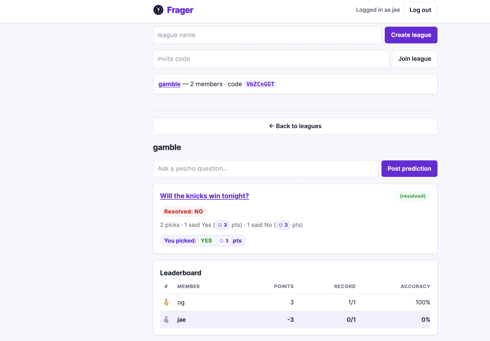

# Frager

**A social prediction game — wagering without the risk.** Create private leagues with
friends, post yes/no predictions, optionally stake points, and climb a leaderboard that
rewards being right. No real money, ever.

A full-stack web app: React frontend, FastAPI backend, PostgreSQL database — built and
deployed end to end.



- **Live app:** https://frager-ten.vercel.app
- **API:** https://frager-backend.onrender.com

---

## What it does

- **Accounts** — sign up with an email, a public nickname, and a password.
- **Sessions** — short-lived access tokens with rotating refresh tokens; the app renews
  them silently, and "Log out all" revokes every device immediately.
- **Leagues** — create a private league and invite friends with a shareable link or a short
  invite code.
- **Manage** — owners can rename or delete a league; members can leave. Deleting a league
  cascades its memberships, predictions, and picks.
- **Hand over** — an owner can transfer a league to another member; they stay a member
  afterwards and can then leave, so nobody gets stuck owning a league they are done with.
- **Predictions** — anyone in a league posts a yes/no question.
- **Picks** — members pick a side and optionally stake points.
- **Reveal** — you can only see everyone else's picks *after* you've made your own
  (or once the prediction is resolved), so nobody can snipe the crowd.
- **Resolve** — the creator settles the outcome.
- **Results & leaderboard** — correct picks earn `+stake`, wrong picks lose `−stake`;
  a derived leaderboard ranks members by points, then accuracy.
- **Live updates** — open leagues push picks, resolutions, and leaderboard changes over a
  WebSocket, so the page updates without a refresh (with automatic reconnect and an HTTP
  fallback).
- **NFL auto-resolve** — post a prediction with an ESPN game link and Frager settles it
  from the final score (a manual resolve always wins).

## Tech stack

| Layer     | Choice                          |
|-----------|---------------------------------|
| Frontend  | React (Vite)                    |
| Backend   | FastAPI (Python)                |
| Database  | PostgreSQL                      |
| Auth      | JWT (python-jose) + bcrypt + rotating refresh tokens |
| Real-time | WebSockets (FastAPI)            |
| Hosting   | Vercel (frontend) · Render (API) · Neon (DB) |

## Architecture

```
React (Vercel)  ──HTTP/JSON──▶  FastAPI (Render)  ──SQLAlchemy──▶  PostgreSQL (Neon)
   localStorage JWT              /api/... routers                    users, leagues,
        │  ▲                     /ws/leagues/{id}                    memberships,
        └──┘  WebSocket events   bcrypt + JWT auth                   predictions, picks
```

- **Auth:** passwords are bcrypt-hashed; access is via a signed JWT sent as a Bearer token.
- **Authorization:** league endpoints verify membership; only a prediction's creator may resolve it.
- **Leaderboard is derived, not stored:** it is computed from settled picks on every request,
  so it can never drift out of sync.
- **Anti-snipe:** the pick list is gated server-side — you can't see others' picks until you
  commit your own (or the prediction is resolved).
- **Hardened:** auth endpoints are rate limited, passwords need 8+ characters, inputs are
  length-limited (league name 1–100, question 1–500), and every response carries security
  headers.

## Project layout

```
frager/
├── backend/
│   ├── app/
│   │   ├── main.py              FastAPI app, CORS, security headers, /ws route
│   │   ├── database.py          SQLAlchemy engine/session + Base
│   │   ├── models.py            User, League, Membership, Prediction, Pick
│   │   ├── schemas.py           Pydantic request/response models
│   │   ├── security.py          hashing, JWT, get_current_user, get_db
│   │   ├── membership.py        is_member / require_member helpers
│   │   ├── rate_limit.py        slowapi limiter (per-account / per-user / per-IP keys)
│   │   ├── ws.py                WebSocket connection manager (per league)
│   │   ├── routes_auth.py       /api/auth/*
│   │   ├── routes_leagues.py    /api/leagues/*
│   │   ├── routes_predictions.py /api/leagues/{id}/predictions, /api/predictions/*
│   │   └── services/            ESPN client + auto-resolve helper
│   ├── create_tables.py         create_all against DATABASE_URL
│   ├── migrate_v4.py            ALTER predictions (resolution columns)
│   ├── migrate_v7.py            ALTER users (nickname, backfill + unique index)
│   ├── migrations/              migrate_v14_auto_resolve.py,
│   │                            migrate_v18_cascades.py,
│   │                            migrate_v20_sessions.py
│   ├── tests/                   conftest.py, test_smoke_flows.py,
│   │                            test_m14_auto_resolve.py, test_m18_validation.py,
│   │                            test_m19_league_management.py, test_m20_sessions.py,
│   │                            test_m21_ownership_transfer.py,
│   │                            test_m22_ws_broadcast.py, test_m23_rate_limits.py
│   ├── render.yaml
│   └── requirements.txt
└── frontend/
    └── src/App.jsx              auth, leagues, league view, picks, leaderboard, WS client
```

## Testing

```bash
cd backend
pip install pytest httpx       # test runner + TestClient transport (if not installed)
python -m pytest tests         # 92 tests: smoke flows, auto-resolve, validation, cascades,
                                # league management, sessions, ownership transfer,
                                # websocket broadcasts, rate limits
```

```bash
cd frontend
npm install                      # once: includes the test tooling
npm test                         # 35 tests: helpers, API error/retry, transfer UI, auth screen
npm run build                   # production build
```


## Running locally

**Prerequisites:** Python 3.10+, Node 18+, and a PostgreSQL `DATABASE_URL` (a free
[Neon](https://neon.tech) database works).

### Backend

```bash
cd backend
python -m venv .venv
source .venv/bin/activate            # Windows: .venv\Scripts\activate
pip install -r requirements.txt
cp .env.example .env                 # set DATABASE_URL, SECRET_KEY, ACCESS_TOKEN_EXPIRE_MINUTES
python create_tables.py              # create tables (and run migrate_v*.py on existing DBs)
python -m migrations.migrate_v14_auto_resolve   # only for DBs created before M14
python -m migrations.migrate_v18_cascades       # only for DBs created before M18
python -m migrations.migrate_v20_sessions       # only for DBs created before M20
uvicorn app.main:app --reload --port 8000
```

Verify: `curl http://localhost:8000/api/health` → `{"status":"ok"}`

### Frontend

```bash
cd frontend
npm install
npm run dev                          # http://localhost:5173
```

The frontend reads its API URL from `VITE_API_URL` (falls back to `http://localhost:8000`).

## API

All league/prediction endpoints require a `Bearer` token. Emails are never exposed to
other users — only nicknames.

| Method | Path                                     | Body                     | Success | Errors |
|--------|------------------------------------------|--------------------------|---------|--------|
| GET    | `/api/health`                            | —                        | 200 `{"status":"ok"}` | — |
| POST   | `/api/auth/signup`                       | `{email, nickname, password}` | 201 `{access_token, refresh_token}` | 409 email/nickname taken |
| POST   | `/api/auth/login`                        | `{email, password}`      | 200 `{access_token, refresh_token}` | 401 bad credentials |
| POST   | `/api/auth/refresh`                      | `{refresh_token}`        | 200 new token pair | 401 invalid/expired/revoked/reused |
| POST   | `/api/auth/logout`                       | `{refresh_token}`        | 200 `{"ok": true}` | — |
| POST   | `/api/auth/logout-all`                   | —                        | 200 `{"ok": true}` (all sessions revoked) | 401 |
| GET    | `/api/auth/me`                           | —                        | 200 `{id, email, nickname}` | 401 |
| POST   | `/api/leagues`                           | `{name}`                 | 201 league | 401 |
| GET    | `/api/leagues`                           | —                        | 200 user's leagues | 401 |
| GET    | `/api/leagues/{id}`                      | —                        | 200 league (members) | 404 |
| POST   | `/api/leagues/join`                      | `{invite_code}`          | 200 league | 404 unknown code, 409 already a member |
| PATCH  | `/api/leagues/{id}`                      | `{name}`                 | 200 league (owner) | 403 non-owner, 404 non-member |
| DELETE | `/api/leagues/{id}`                      | —                        | 200 `{"ok": true}` (owner; cascades) | 403 non-owner, 404 non-member |
| POST   | `/api/leagues/{id}/leave`                | —                        | 200 `{"ok": true}` | 409 owner, 404 non-member |
| GET    | `/api/leagues/{id}/members`              | —                        | 200 `[{user_id, nickname, is_owner}]` | 404 non-member |
| POST   | `/api/leagues/{id}/transfer`             | `{new_owner_id}`         | 200 league (new owner) | 403 non-owner, 404 target not a member, 400 self-transfer, 409 ownership changed |
| POST   | `/api/leagues/{id}/predictions`          | `{question, game_url?}`  | 201 prediction | 404 non-member, 400 bad game link |
| GET    | `/api/leagues/{id}/predictions`          | —                        | 200 list w/ counts + stakes | 404 non-member |
| POST   | `/api/predictions/{id}/pick`             | `{side, stake}`          | 201 new / 200 updated | 404, 409 resolved, 422 bad side/stake |
| GET    | `/api/predictions/{id}`                  | —                        | 200 detail (picks gated by `picks_visible`) | 404 |
| POST   | `/api/predictions/{id}/resolve`          | `{outcome}`              | 200 resolved | 404, 403 non-creator, 409 already resolved |
| GET    | `/api/leagues/{id}/leaderboard`          | —                        | 200 members ranked (points/record/accuracy) | 404 non-member |
| WS     | `/ws/leagues/{id}?token=<jwt>`           | —                        | events: `prediction_created`, `pick_updated`, `prediction_resolved`, `leaderboard_updated`, `league_updated` | closed if token invalid or not a member |

## Notes

- **Rate limits:** `POST /api/auth/signup` allows 5/minute, `POST /api/auth/login`
  10/minute, `POST /api/auth/refresh` 60/minute, and the logout endpoints 30/minute;
  exceeding any returns `429`. Signup and login are limited **per account** as well as per
  address, so guessing one password is capped at 10 attempts a minute even from many
  addresses and with forged forwarding headers. The write endpoints (create/join/rename/
  delete/leave/transfer, create/pick/resolve) are limited per signed-in user.
- **Sessions:** access tokens last `ACCESS_TOKEN_EXPIRE_MINUTES` (default 60); refresh tokens
  last `REFRESH_TOKEN_EXPIRE_DAYS` (default 30), are stored only as SHA-256 hashes, and rotate
  on every use. Replaying a rotated token after a 15-second grace window revokes every
  session. "Log out all" bumps a per-user token version, invalidating outstanding access
  tokens immediately. Tokens live in `localStorage` (the usual XSS trade-off); an httpOnly
  cookie mode is a possible future hardening step.
- **Passwords:** signup and login require 8–128 characters.
- **Input limits:** league names are 1–100 characters; prediction questions are 1–500
  (whitespace is trimmed). Validation is enforced on both the client and the server.
- **League management:** only the owner can rename or delete a league; members can leave.
  The owner cannot leave — they transfer the league to another member or delete it. Every
  league has a shareable invite link (`/?join=CODE`) that pre-fills the join form.
- **Deleting data:** core foreign keys are `ON DELETE CASCADE`, so deleting a league (or a
  user) cleans up its memberships, predictions, and picks. Existing databases need
  `python -m migrations.migrate_v18_cascades` once — the delete endpoints require it (see
  DEPLOY.md).
- **Free-tier hosting:** the API sleeps after inactivity, so the first request can take
  ~30–60s to wake. The frontend shows a friendly "Waking up the server…" state and
  auto-retries, rather than failing.
- **Deployment:** see [DEPLOY.md](DEPLOY.md) for the Neon + Render + Vercel setup.
